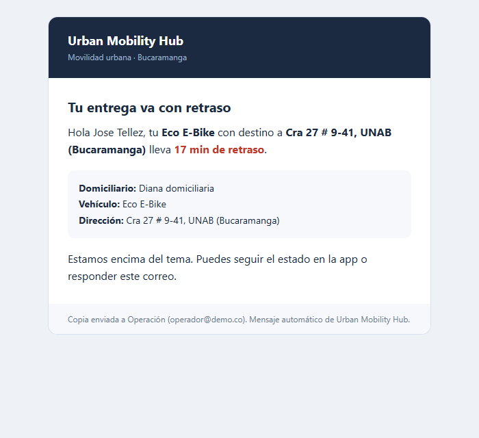

# Integraciones: Bold (pagos) y Brevo (correo)

Ambas son opcionales: sin llaves la app usa una pasarela simulada y correos `simulated`.
Las llaves viven solo en `/etc/umh/umh.env` de la VM (root:umh, 640), **nunca en git**.

## Bold — pagos (sandbox)

| Variable            | Valor                                                               |
| ------------------- | ------------------------------------------------------------------- |
| `BOLD_IDENTITY_KEY` | llave de identidad de **pruebas**                                   |
| `BOLD_SECRET_KEY`   | llave secreta de **pruebas** (firma la orden del checkout embebido) |
| `BOLD_ENV`          | `test`                                                              |
| `UMH_PUBLIC_URL`    | `https://urbanmobility.duckdns.org` (URL de retorno)                |

Las dos llaves deben ser del mismo ambiente. Código: `src/server/services/bold.ts`.

Flujo: el cliente paga (compra o prepago de reserva) → `POST /api/payments` crea la orden
`BLD-…` y devuelve `embedded` con la firma de integridad → el checkout se abre dentro de la
página → Bold redirige a `/pago/resultado?order=…` → la app consulta el estado de la orden
(en pruebas Bold no manda webhooks solos). Webhook (público, validado por firma):
`https://urbanmobility.duckdns.org/api/payments/bold/webhook`; regístralo en el panel de Bold.

Verificado en producción el 2026-11-13:

```bash
# tras iniciar sesión como cliente y crear una compra
curl -s -b c.txt -X POST https://urbanmobility.duckdns.org/api/payments \
  -H 'content-type: application/json' -d '{"ownerType":"purchase","ownerId":"<PUR-id>"}'
# → {"status":"pending","orderId":"BLD-…","embedded":{…,"integritySignature":"…"}}
```

Pantalla de retorno: `capturas/09-pago-bold-resultado.png`. La captura del checkout embebido
no se tomó porque requiere completar el pago en el sandbox de Bold.

## Brevo — correo transaccional

| Variable        | Valor                                                            |
| --------------- | ---------------------------------------------------------------- |
| `BREVO_API_KEY` | API key v3 (`xkeysib-…`)                                         |
| `BREVO_SENDER`  | remitente **verificado** en Brevo (hoy `jtellez312@unab.edu.co`) |

Código: `src/server/services/brevo.ts` (REST con `fetch`, sin SDK). El correo de retraso
(UC19 / RF-27) se envía **una vez por entrega** al cliente y a Operación; si Brevo falla queda
`failed` en `notifications` y la operación no se rompe.

### Requisito: IPs autorizadas

Brevo rechaza llamadas desde IPs no autorizadas (`401 unrecognised IP address`). Agrega la IP de
la VM (`20.221.192.0`) y, si pruebas desde tu PC, la tuya en
<https://app.brevo.com/security/authorised_ips>. **Si cambias de VM, repite este paso.**

### Cómo deben verse los correos

Plantilla "entrega con retraso": HTML con tablas y estilos en línea (compatible con clientes de
correo), generada por `renderTemplate()` y guardada en `correos/entrega-tardia.html`.
Asunto: _Tu entrega va con retraso — Urban Mobility Hub_. Los datos del usuario se escapan
antes de entrar al HTML.



### Prueba de envío

Con la IP autorizada:

```bash
curl -s -X POST https://api.brevo.com/v3/smtp/email -H "api-key: $BREVO_API_KEY" \
  -H 'content-type: application/json' \
  -d '{"sender":{"name":"Urban Mobility Hub","email":"jtellez312@unab.edu.co"},"to":[{"email":"jtellez312@unab.edu.co"}],"subject":"Prueba UMH","htmlContent":"<b>ok</b>"}'
```

Respuesta esperada: `{"messageId":"<…>"}`. La bitácora de correos aparece al final de `/admin`.
