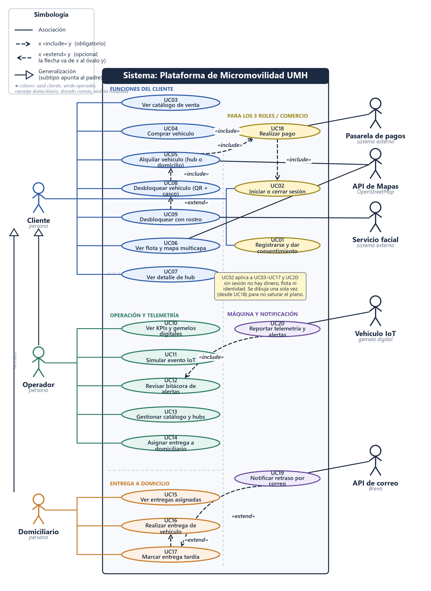
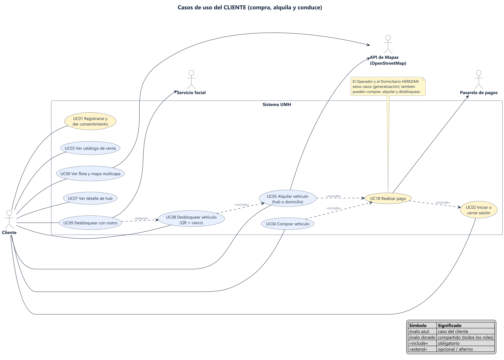
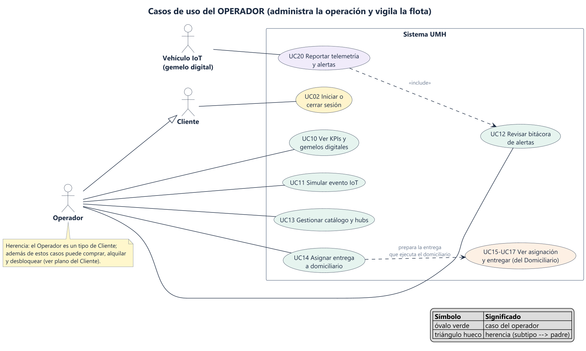
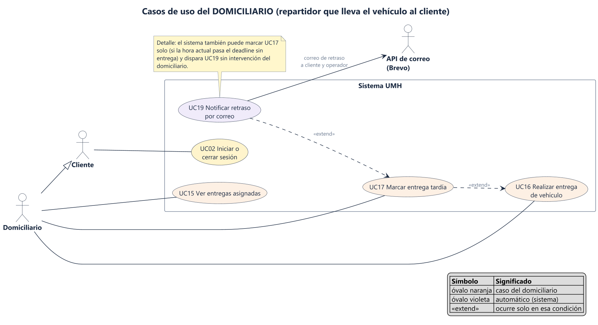
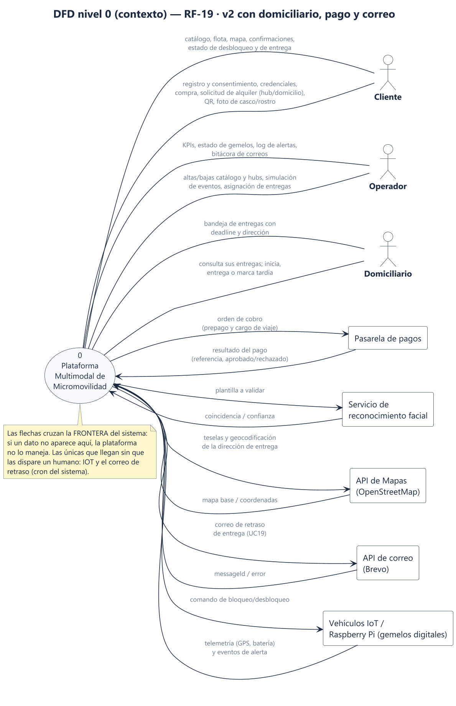
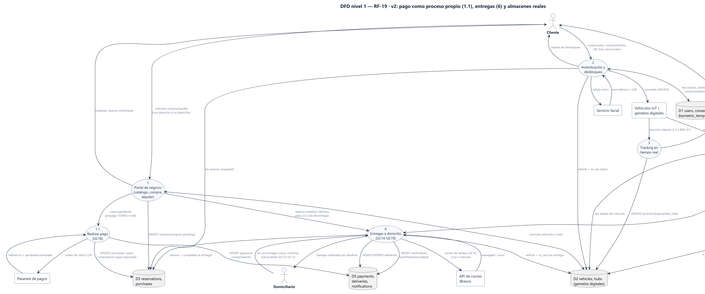

# Artefactos de análisis

Fase SDLC: **Análisis** (qué debe hacer el sistema, sin decir todavía cómo).
El plano maestro de casos de uso se genera con `python ../_tools/casos_de_uso.py` (simbología UML
estricta, layout determinista); los planos por rol y los DFD están en PlantUML (`src/*.puml`) y se regeneran
con `powershell -File ../_tools/render-uml.ps1`. Versiones anteriores archivadas en `mmd/_v1/` e `img/_v1/`.

> **v2 (8-oct-2026).** Cambios: "Usuario final" pasa a llamarse **Cliente**; nuevo actor **Domiciliario**;
> nuevos externos **API de Mapas** y **API de correo (Brevo)**; nuevo caso abstracto **UC18 Realizar pago**
> (lo incluyen Comprar y Alquilar); nuevos casos de entrega **UC14–UC17** y de notificación **UC19**;
> el Operador y el Domiciliario **heredan** del Cliente (triángulo hueco). Layout: a la izquierda los casos
> de cada rol, a la derecha los compartidos por los tres (UC01/UC02/UC18).

**Cómo leer este documento:** cada artefacto trae tres bloques: _Qué es_, _Por qué existe_ y _Cómo leerlo_. Si solo tienes 5 minutos, lee el DFD nivel 0 y el plano maestro de casos de uso.

---

## 1. Diagrama de casos de uso — plano maestro

**Qué es.** Un mapa de _quién_ usa el sistema y _para qué_, con simbología UML estricta: monigote = actor, óvalo = caso de uso, línea continua = iniciación, flecha punteada = `«include»` (obligatorio) / `«extend»` (opcional, la flecha va del caso que extiende al caso base), triángulo hueco = herencia.

**Por qué existe.** Antes de diseñar hay que ponerse de acuerdo en el alcance. La v2 cerró tres huecos detectados al cruzar código y diagramas v1: no existía el rol que ejecuta las entregas a domicilio (`reservations.modality='delivery'` no lo consumía nadie), el pago estaba "invisible" (mezclado dentro de compra y alquiler), y los externos que el código ya usa (mapas) o usará (correo) no estaban dibujados.

**Cómo leerlo.**

- Izquierda: actores humanos. Centro-izquierda: sus casos por rol (azul = Cliente, verde = Operador, naranja = Domiciliario). Centro-derecha: casos **compartidos por los tres roles** (dorado: UC01, UC02, UC18) y máquina/notificación (violeta: UC19, UC20). Derecha: sistemas externos (gris).
- `Comprar` y `Alquilar` **incluyen** `UC18 Realizar pago`; el pago **incluye** `UC02 Iniciar sesión` y habla con la Pasarela. Una sola flecha de sesión (nota amarilla): sin sesión no hay dinero, flota ni identidad.
- `Desbloquear con rostro` **extiende** `Desbloquear (QR + casco)`: es el mecanismo alterno de RF-10.
- `Marcar entrega tardía` **extiende** `Realizar entrega`, y `Notificar retraso por correo` **extiende** a su vez de `Marcar entrega tardía`: así el disparador de Brevo queda modelado sin flechas sueltas.
- Herencia: `Operador` y `Domiciliario` son tipos de `Cliente`: también pueden registrarse, comprar, alquilar y desbloquear.

| #    | Caso de uso                         | Actor principal         | Externos              | Requisito                                |
| ---- | ----------------------------------- | ----------------------- | --------------------- | ---------------------------------------- |
| UC01 | Registrarse y dar consentimiento    | Compartido (3 roles)    | —                     | RF-20, RNF-03/05, Ley 1581               |
| UC02 | Iniciar o cerrar sesión             | Compartido (3 roles)    | —                     | RF-21                                    |
| UC03 | Ver catálogo de venta               | Cliente                 | —                     | RF-02                                    |
| UC04 | Comprar vehículo                    | Cliente                 | —                     | RF-03                                    |
| UC05 | Alquilar vehículo (hub o domicilio) | Cliente                 | API de Mapas          | RF-05                                    |
| UC06 | Ver flota y mapa multicapa          | Cliente                 | API de Mapas          | RF-04, RF-06                             |
| UC07 | Ver detalle de hub                  | Cliente                 | —                     | RF-07                                    |
| UC08 | Desbloquear vehículo (QR + casco)   | Cliente                 | Vehículo (comando)    | RF-09                                    |
| UC09 | Desbloquear con rostro              | Cliente                 | Servicio facial       | RF-10 (extiende UC08)                    |
| UC10 | Ver KPIs y gemelos digitales        | Operador                | —                     | RF-13, RF-14                             |
| UC11 | Simular evento IoT                  | Operador                | —                     | RF-15                                    |
| UC12 | Revisar bitácora de alertas         | Operador                | —                     | RF-12, RNF-04                            |
| UC13 | Gestionar catálogo y hubs           | Operador                | —                     | RF-23, RF-24                             |
| UC14 | Asignar entrega a domiciliario      | Operador                | —                     | RF-25 (nuevo)                            |
| UC15 | Ver entregas asignadas              | Domiciliario            | —                     | RF-25                                    |
| UC16 | Realizar entrega de vehículo        | Domiciliario            | —                     | RF-25 (extiende flujo de UC05 domicilio) |
| UC17 | Marcar entrega tardía               | Domiciliario / cron     | —                     | RF-27 (extiende UC16)                    |
| UC18 | Realizar pago                       | Cliente (vía UC04/UC05) | Pasarela de pagos     | RF-26 (nuevo)                            |
| UC19 | Notificar retraso por correo        | Sistema                 | API de correo (Brevo) | RF-27 (extiende UC17)                    |
| UC20 | Reportar telemetría y alertas       | Vehículo IoT            | —                     | RF-08, RF-11, RF-16                      |

### 1a. Plano del Cliente · 1b. Plano del Operador · 1c. Plano del Domiciliario

  

Los tres recortes del maestro, uno por rol, para presentar el alcance sin saturar. Están en `src/*.puml` (PlantUML) y se regeneran con `render-uml.ps1`.

### 1b. Descripciones escritas, plantillas e historias

- `casos-de-uso/` — los 20 casos descritos uno a uno (flujo, alternos, excepciones, reglas con constantes del código). Índice: `casos-de-uso/README.md`.
- `plantillas/` — `plantilla-caso-de-uso.md` y `plantilla-historia-de-uso.md`: el formato con el que se llenó `casos-de-uso/`; sirve para cualquier caso nuevo.
- `historias-de-uso.md` — matriz HU → caso padre → prioridad → horas → semana, con 99 h estimadas y el ajuste de capacidad declarado (no todo cabe en 96 h: UC13 queda _planificado_).

---

## 2. DFD nivel 0 (diagrama de contexto) — RF-19

**Qué es.** El sistema completo como **una sola burbuja** y todo lo que entra y sale de ella. Los rectángulos son quienes se comunican con el sistema (entidades externas) y las flechas son datos, no acciones.

**Por qué existe.** RF-19 exige un DFD que muestre cómo viaja la información entre usuarios, portal, tracking y seguridad IoT. El nivel 0 fija la frontera: qué datos cruzan hacia afuera y hacia adentro. Si un dato no aparece aquí, el sistema no lo maneja.

**Cómo leerlo.** Empieza por el Cliente: lo que envía (registro/consentimiento, credenciales, compra, alquiler —incluida la dirección de domicilio—, QR, fotos) y lo que recibe (catálogo, mapa, confirmaciones, estado de desbloqueo y de entrega). Luego Operador y Domiciliario, y por último los externos: pagos, facial, mapas, correo (Brevo) e IoT. Las flechas de IOT y del correo de retraso son las únicas que se mueven sin humano que las dispare (gemelo simulado y cron de vencimientos).

> v2 (8-oct): "Usuario final" pasa a **Cliente**; nuevos actor **Domiciliario**; nuevos externos **API de Mapas** y **API de correo (Brevo)**; el pago ya no es una flecha suelta: viaja del portal a la pasarela como dato de cobro/resultado.

---

## 3. DFD nivel 1 — RF-19

**Qué es.** La burbuja del nivel 0 abierta en cinco procesos, con los almacenes de datos (cilindros) donde se guarda la información.

**Por qué existe.** Muestra dónde se transforma y se guarda cada dato, que es lo que el SRS pide documentar. También hace visible la responsabilidad de cada módulo (RNF-09: módulos actualizables por separado) y qué almacén toca cada uno.

**Cómo leerlo.** Sigue un recorrido de punta a punta:

1. _Comprar o alquilar:_ Cliente → **P1** → el cobro pasa a **P1.1 Realizar pago** → cobra con la Pasarela → comprobante en **D5** y estado en **D3**. Si es domicilio, la reserva pasa a la cola de **P6**.
2. _Entregar:_ Operador → **P6** (asigna courier + deadline) → **D5**; el Domiciliario inicia/confirma/marca tardía; si hay retraso, **P6** → **API de correo (Brevo)** y el resultado queda en **D5** (`notifications`). Al entregar, cierra **D3** y libera el gemelo en **D2**.
3. _Desbloquear:_ Cliente → **P2** → lee la reserva en **D3**, valida casco/rostro (plantilla cifrada en **D1**, Servicio facial externo) y envía el comando al vehículo.
4. _Ver el mapa:_ Vehículo → **P3** → actualiza **D2** → el cliente ve la posición en ≤ 5 s (RNF-01).
5. _Alerta:_ Vehículo → **P4** → registra en **D4** y notifica al Operador en < 1 s (RNF-02). **P5** inyecta el mismo evento desde el simulador (RF-15) con `origin='simulator'`.

| Proceso / almacén              | Qué hace o guarda (→ tabla real)                                                             | RF                          |
| ------------------------------ | -------------------------------------------------------------------------------------------- | --------------------------- |
| P1 Portal de negocio           | Catálogo, compra y alquiler → `vehicles, hubs, reservations, purchases`                      | RF-01 a RF-07               |
| P1.1 Realizar pago             | Cobro y comprobante → `payments` con referencia de pasarela                                  | RF-26 (v2)                  |
| P2 Autenticación y desbloqueo  | Registro, login, QR, casco, rostro → `users, consents, biometric_templates, unlock_sessions` | RF-09, RF-10, RF-20, RF-21  |
| P3 Tracking                    | Recibe telemetría y la publica al mapa → UPDATE `vehicles`                                   | RF-08, RF-16, RF-17         |
| P4 Seguridad IoT               | Evalúa 4 reglas, crea alertas → `alert_log` (solo-append)                                    | RF-11, RF-12                |
| P5 Administración y telemetría | KPIs, gemelos, simulador, CRUD                                                               | RF-13 a RF-15, RF-23, RF-24 |
| P6 Entregas a domicilio        | Asignación, ejecución, tardía y correo → `deliveries, notifications`                         | RF-25, RF-27 (v2)           |
| D1                             | Usuarios, consentimientos, plantillas biométricas **cifradas**                               | RNF-03, RNF-05              |
| D2                             | Flota y hubs (gemelos digitales)                                                             | RF-16, RF-17                |
| D3                             | Reservas y compras                                                                           | RF-03, RF-05                |
| D4                             | Log de alertas auditable                                                                     | RF-12, RNF-04               |
| D5                             | Pagos con comprobante, entregas y notificaciones                                             | RF-25, RF-26, RF-27         |

**Diccionario de datos (mínimo).**

| Flujo                   | Contenido                                                                                                                        |
| ----------------------- | -------------------------------------------------------------------------------------------------------------------------------- |
| Telemetría              | `vehicleId`, lat, lng, batería, casco, impacto, edad del fix GPS, viaje activo, marca de tiempo                                  |
| Evento de alerta        | `vehicleId`, tipo (`no_helmet`, `crash`, `gps_lost`, `low_battery`), lat, lng, marca de tiempo, origen (`telemetry`/`simulator`) |
| Comando de desbloqueo   | `vehicleId`, acción, `reservationId`                                                                                             |
| Resultado de pago       | referencia, estado (aprobado/rechazado), monto en COP, owner (compra o reserva)                                                  |
| Asignación de entrega   | `reservationId`, `courierId`, `deadline_at`, dirección del cliente                                                               |
| Notificación de retraso | `deliveryId`, destinatarios (cliente+operador), plantilla `entrega_tardia`, estado del envío (`sent/failed/simulated`)           |

---

## 4. Trazabilidad de los artefactos con los requisitos

| Requisito                    | Casos de uso                             | DFD                    | Diseño (ver `../diseno/`)                            |
| ---------------------------- | ---------------------------------------- | ---------------------- | ---------------------------------------------------- |
| RF-01 a RF-07                | UC03–UC07 (descritos en `casos-de-uso/`) | P1, D2, D3             | componentes, clases, secuencias 11/12                |
| RF-08, RNF-01                | UC06, UC20                               | P3, D2                 | secuencia de alerta (rama "sin novedad")             |
| RF-09, RF-10                 | UC08, UC09                               | P2, D1                 | secuencia de desbloqueo                              |
| RF-11, RF-12, RNF-02, RNF-04 | UC12, UC20                               | P4, D4                 | secuencia de alerta, estados del vehículo            |
| RF-13 a RF-17                | UC10, UC11, UC20                         | P5, D2                 | componentes, DER                                     |
| RF-19                        | —                                        | §2–3 de este documento | —                                                    |
| RF-20 a RF-22                | UC01, UC02, UC09                         | P2, D1                 | secuencia de autenticación (14)                      |
| RF-23, RF-24                 | UC13                                     | P5                     | endpoints admin del contrato; UI planificada (HU-13) |
| RF-25 (domiciliario)         | UC14–UC17                                | **P6**, D5             | secuencia de entrega (13), estados de entrega (15)   |
| RF-26 (pago)                 | UC18                                     | **P1.1**, D5           | secuencias 11/12/14, DER `payments`                  |
| RF-27 (correo de retraso)    | UC19                                     | **P6** → Brevo, D5     | secuencia 13, estados 15                             |

## 5. Supuestos y límites

- Los RF _(propuesto/nuevo)_ (RF-20 a RF-24 en `../gestion/SRS_v1.2.md`; RF-25 a RF-27 APROBADOS el 8-oct) ya son código: backend SQLite `src/server/db/schema.sql`, las 12 tablas reales citadas en las secuencias de `../diseno/`.
- El DFD v2 (8-oct) ya dibuja `payments`, `deliveries` y `notifications` (P1.1, P6, D5) alineado con el DER del diseño: documentación y base de datos dicen lo mismo.
- La Pasarela de pagos, el Servicio facial, la API de Mapas y la API de correo (Brevo) son externos: en el entorno de demostración la pasarela está simulada y Brevo funciona con clave real o en modo `simulated` (la demo nunca se rompe).
