# Artefactos de diseño

Fase SDLC: **Diseño** (cómo se organiza el sistema para cumplir lo definido en `../analisis/`).
Fuentes: diagramas UML en PlantUML (`src/*.puml`) y DFD/C4 en Mermaid (`mmd/*.mmd`). PNG/SVG en `img/`.
Regenerar: `powershell -File ../_tools/render-uml.ps1` (PlantUML) y `sh ../_tools/render.sh` (Mermaid).
Los `.mmd` reemplazados por PlantUML quedaron archivados en `mmd/_v1/`.

> **Estado y honestidad (8-oct-2026, v2 · backend YA implementado).** Los participantes de las secuencias
> nombran **tablas reales de SQLite** (`vehicles`, `reservations`, `payments`, `deliveries`, `alert_log`,
> `unlock_sessions`, `notifications`…), endpoints concretos (`/api/unlock/*`) y servicios del repo
> (`server/domain/alerts.ts`, `server/services/brevo.ts`). Esas tablas existen en `src/server/db/schema.sql`
> (12 tablas, sembradas y con 76 pruebas unitarias/de integración + smoke de 13 pasos por encima).
> El rol `courier` existe en `users.role` y en la UI (`/entregas`). Lo único que sigue siendo arquitectura
> _objetivo_ es el despliegue (D1 + Durable Objects + MQTT), marcado en cada sección y en `../gcs/despliegue.md`.

Cada artefacto trae _Qué es / Por qué existe / Cómo leerlo_.

---

## 1. Arquitectura C4 — nivel 1: Contexto

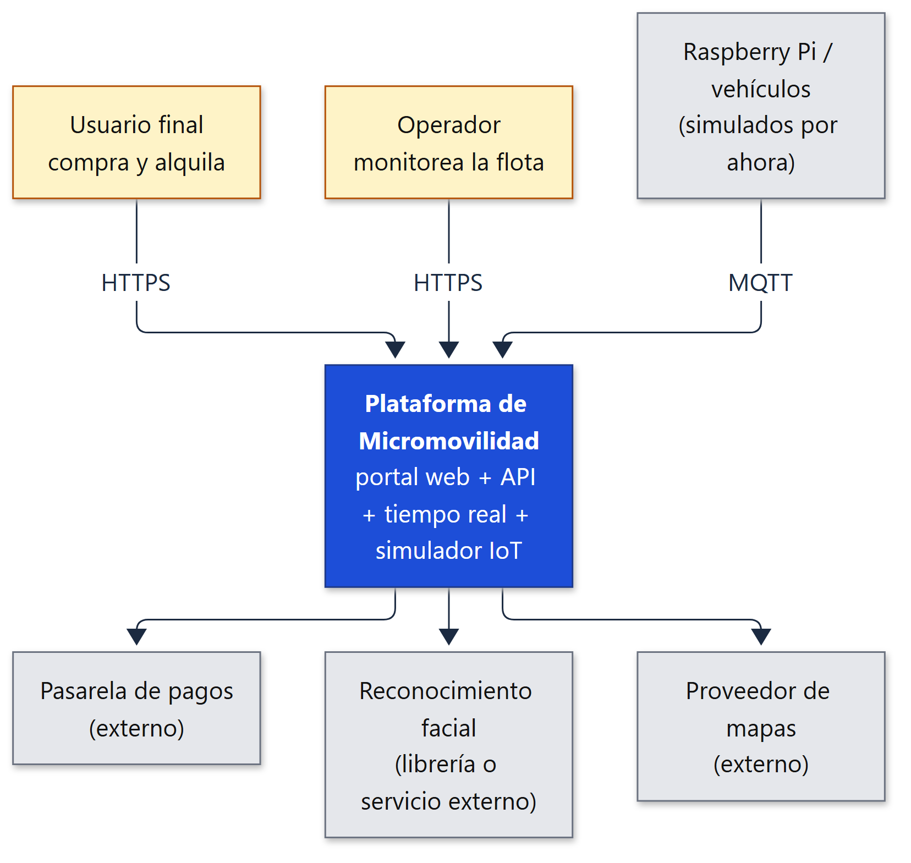

**Qué es.** El sistema como una caja rodeada de las personas y sistemas con los que habla.
**Por qué existe.** Alguien nuevo entiende en 10 segundos qué construimos y de quién dependemos.
**Cómo leerlo.** Azul = lo nuestro. Gris = externos que no controlamos: ahora incluye explícitamente **API de Mapas** y **API de correo (Brevo)**, además de Pasarela de pagos y Servicio facial. Amarillo = personas (Cliente, Operador, Domiciliario).

## 2. Arquitectura C4 — nivel 2: Contenedores

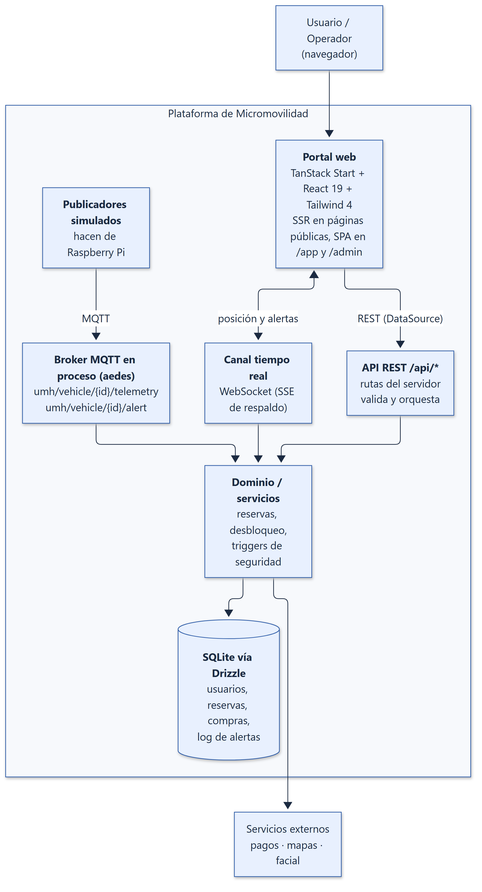

**Qué es.** La caja abierta en piezas desplegables: portal, API, SQLite (Drizzle), canal tiempo real, simulador, cron de entregas y la llamada saliente a Brevo.
**Por qué existe.** Mapa para decidir dónde tocar al implementar un cambio.
**Cómo leerlo.** Petición/respuesta: Portal → `/api/*` → dominio → tablas. Flujo continuo: Simulador → ingest → SSE → Portal. En producción el SQLite local se intercambia por **D1** (mismo esquema Drizzle, ver `../gcs/despliegue.md`).

## 3. Diagrama de componentes

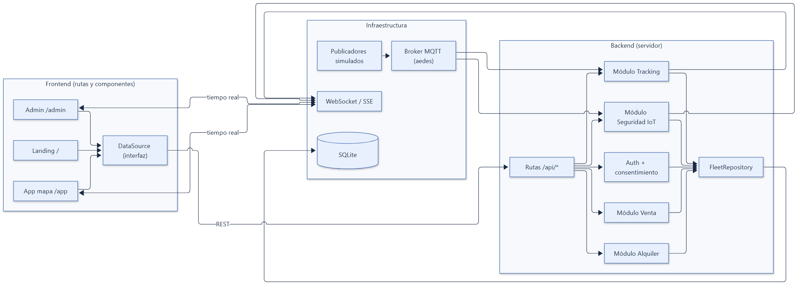

**Qué es.** Módulos internos y dependencias.
**Por qué existe.** Respalda RNF-09 (módulos actualizables por separado) y RNF-08.
**Cómo leerlo.** Pantallas → `DataSource` → rutas `/api/*` → módulos → repositorio → SQLite. Ninguna pantalla toca la BD directamente; esa regla se revisa en las inspecciones de arquitectura del plan SQA.

## 4. Diagrama de despliegue

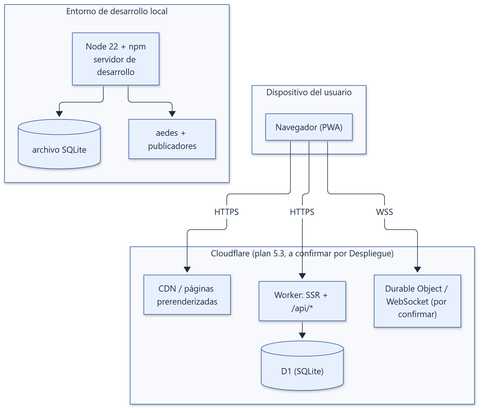

**Qué es.** Dónde corre cada pieza en producción y en local.
**Por qué existe.** Cloudflare Workers impone límites (no `aedes`, no binarios nativos); `../gcs/despliegue.md` §4 los documenta.
**Cómo leerlo.** Izquierda navegador; centro borde Cloudflare (D1 + Durable Object); abajo entorno local en un solo proceso.

## 5. Diagrama de clases (POO)

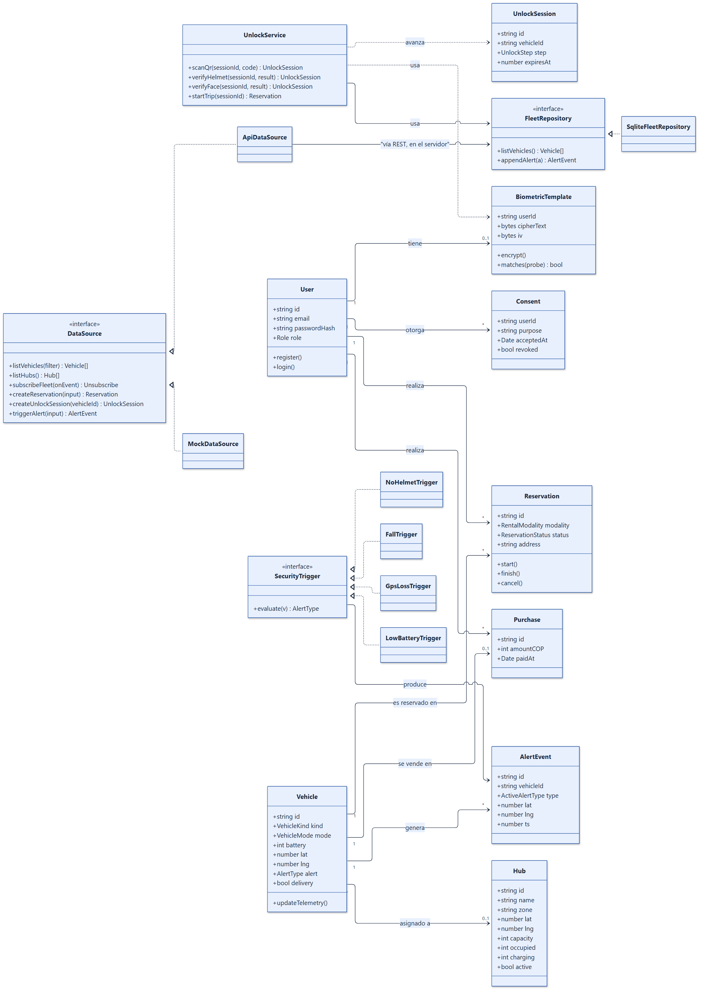

**Qué es.** Clases del dominio, atributos y relaciones.
**Por qué existe.** Vista orientada a objetos; base de los tipos TypeScript compartidos.
**Cómo leerlo.** Rombo = composición; triángulo punteado = implementa interfaz; flecha punteada = depende de.

Principios POO presentes:

| Principio                   | Dónde se ve                                                                               | Beneficio                             |
| --------------------------- | ----------------------------------------------------------------------------------------- | ------------------------------------- |
| **Abstracción**             | `Vehicle`, `Hub`, `Reservation` modelan solo lo relevante                                 | Modelo pequeño y entendible           |
| **Encapsulamiento**         | `BiometricTemplate` expone `encrypt()`/`matches()`; nadie ve el texto plano               | RNF-03                                |
| **Interfaz + polimorfismo** | `DataSource` con implementaciones `mock`/`api`; en el servidor, repositorios sobre SQLite | RNF-10, mitiga RD5                    |
| **Herencia/implementación** | Cuatro `SecurityTrigger` (casco, caída, GPS, batería); `PaymentGateway` simulada y real   | Agregar una regla sin tocar las otras |
| **Bajo acoplamiento**       | `UnlockService` depende de interfaces, no de implementaciones                             | Pruebas con dobles (RD13)             |

## 6. Secuencia: desbloqueo (UC08/UC09)

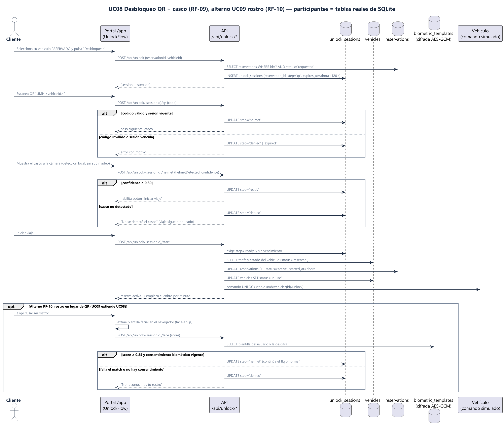

**Qué es.** Orden exacto de mensajes del desbloqueo QR + casco, con el alterno de rostro.
**Por qué existe.** Módulo más crítico (RD7): "Iniciar viaje" solo se habilita con casco verificado.
**Cómo leerlo.** Cada paso escribe en una tabla nombrada: `INSERT unlock_sessions (step='qr', expires_at=ahora+120 s)` → `UPDATE ... step='helmet'` → `step='ready'` → al iniciar viaje: `UPDATE reservations SET status='active'` y `UPDATE vehicles SET status='in-use'`. La sesión exige `reservationId` (contrato de `domain.ts`). Casos de prueba derivados: casco sin confianza ≥ 0.80 ⇒ `denied`; TTL vencido ⇒ `expired`; `start` fuera de `ready` ⇒ rechazado; rostro con score < 0.85 o sin consentimiento biométrico ⇒ `denied` + incidente.

## 7. Secuencia: alerta de seguridad (UC20/UC12/UC11)

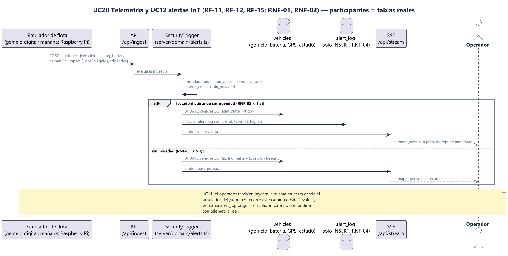

**Qué es.** Recorrido de la telemetría desde el gemelo digital hasta el panel del operador.
**Por qué existe.** Ancla RNF-01 (≤ 5 s), RNF-02 (< 1 s) y RNF-04 (log solo-append).
**Cómo leerlo.** `POST /api/ingest` → `SecurityTrigger` (`server/domain/alerts.ts`, prioridad caida > sin_casco > perdida_gps > bateria_critica) → `UPDATE vehicles` + `INSERT alert_log (origin='telemetry')` → SSE. El simulador del operador usa el mismo camino con `origin='simulator'`.

## 8. Secuencia: compra con pago (UC04 → UC18) _(nuevo v2)_

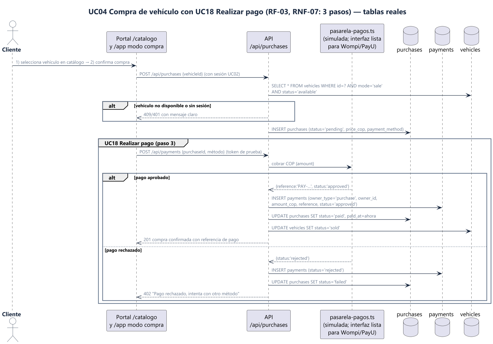

**Qué es.** La compra de un vehículo con el caso de pago como paso explícito.
**Por qué existe.** Antes el "pago" estaba inline en la creación de la compra; UC18 exige su propio registro (`payments`) con referencia de pasarela, y la misma secuencia se reutiliza en alquiler.
**Cómo leerlo.** Transacciones nominadas por tabla: `INSERT purchases (status='pending')` → pasarela → `INSERT payments` → `UPDATE purchases SET status='paid'` → `UPDATE vehicles SET status='sold'`. La rama `rejected` deja `purchases.status='failed'` (el vehículo NO se marca vendido: se prueba).

## 9. Secuencia: alquiler con pago (UC05 → UC18) _(nuevo v2)_

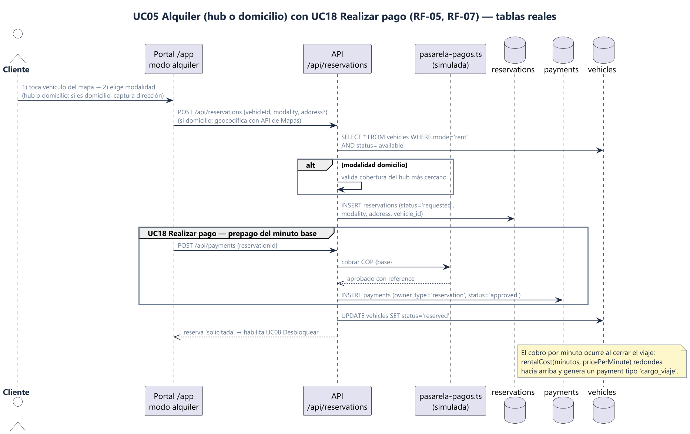

**Qué es.** Reserva en modalidad hub o domicilio, con prepago base y cobro por minuto al cerrar.
**Por qué existe.** Cierra el hueco entre "reservar" y "pagar": el viaje genera su propio `payments (kind='cargo_viaje')` con `rentalCost()` (ceil de minutos).
**Cómo leerlo.** `INSERT reservations (status='requested')` → `vehicles SET status='reserved'` → la nota explica el cargo diferido; el cierre está en §11.

## 10. Secuencia: entrega a domicilio (UC14–UC17 + UC19 Brevo) _(nuevo v2)_

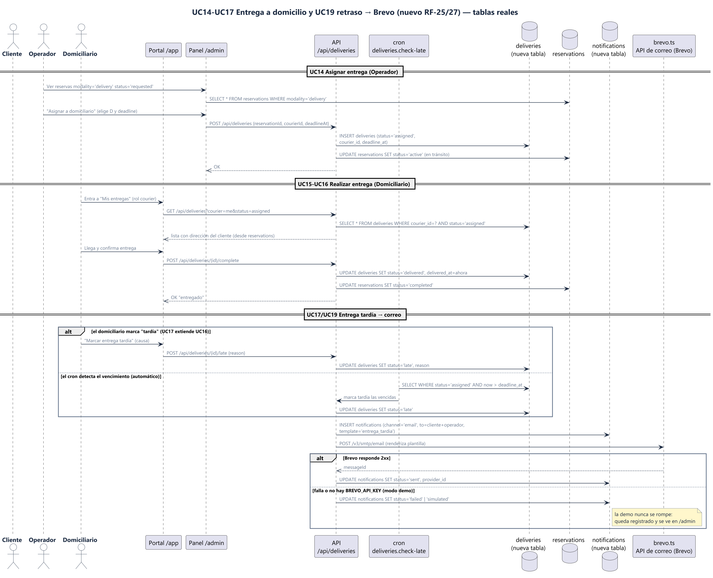

**Qué es.** El ciclo de vida de una entrega: el Operador asigna, el Domiciliario ejecuta, y si se pasa del deadline se notifica por correo.
**Por qué existe.** Da sustento gráfico al actor Domiciliario (faltaba) y al disparador de entrega tardía vía **API de Brevo** (UC19).
**Cómo leerlo.** Tres bloques con `==`: asignación (`INSERT deliveries (status='assigned', deadline_at)`), ejecución (`GET /api/deliveries?courier=me`, `UPDATE ... 'delivered'`), y la rama de retraso: `UPDATE deliveries SET status='late'` → `INSERT notifications` → `POST /v3/smtp/email`. Si Brevo falla o no hay `BREVO_API_KEY`, la fila queda `failed`/`simulated`: **la demo nunca se rompe**.

## 11. Secuencia: registro, login y cierre de viaje (UC01/UC02) _(nuevo v2)_

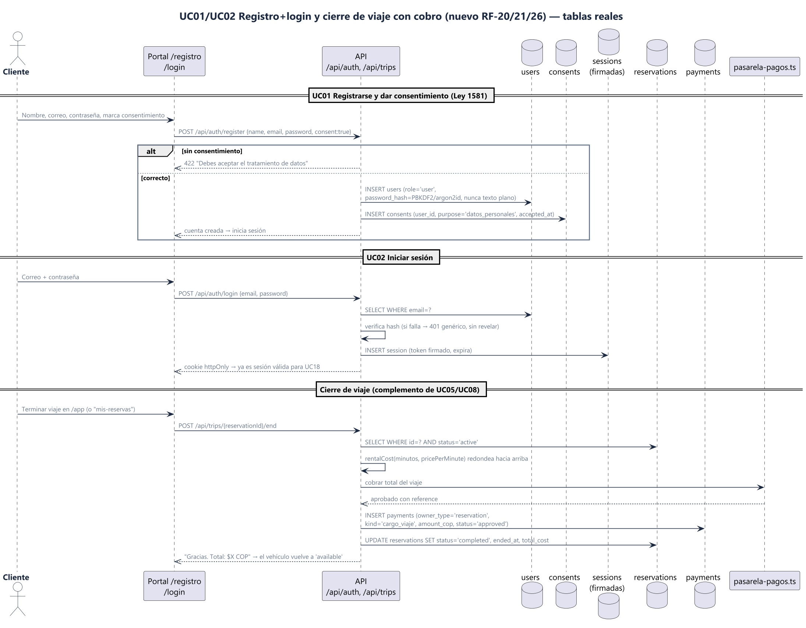

**Qué es.** Registro con consentimiento (Ley 1581), login con hash y sesión firmada, y el cierre del viaje que cobra.
**Por qué existe.** RF-20/RF-21 aprobados; RNF-05 prohíbe contraseñas en texto plano; el cobro del viaje es un pago real con referencia.
**Cómo leerlo.** Registro: `INSERT users (password_hash=...)` + `INSERT consents (purpose='datos_personales')` (sin consentimiento ⇒ 422). Login: `SELECT users` + verificación + sesión firmada httpOnly. Cierre: `rentalCost` → pasarela → `INSERT payments` → `UPDATE reservations SET status='completed'`.

## 12. Estados de la reserva

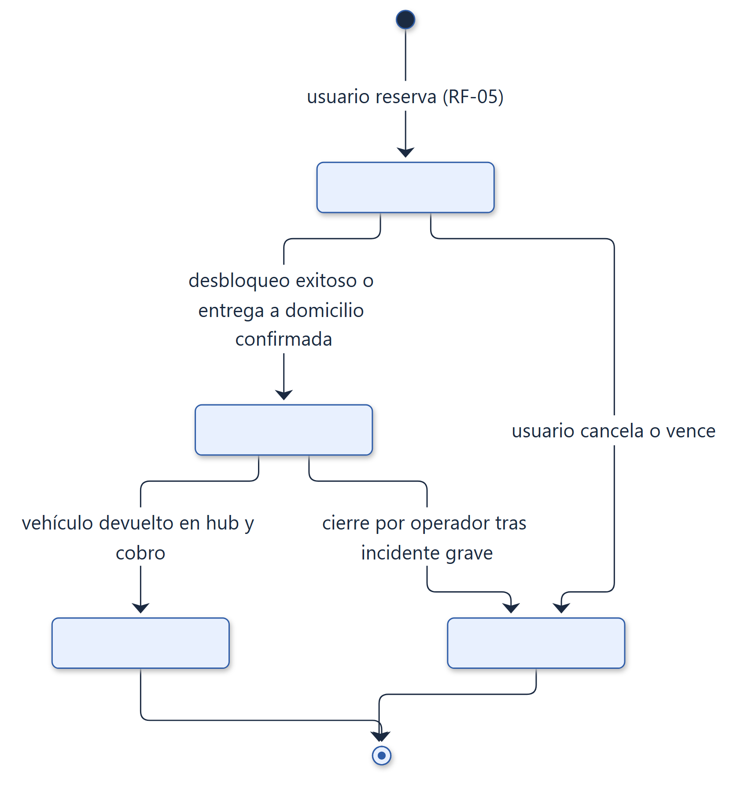

**Qué es/por qué.** Estados de `reservations` y transiciones válidas (máquina en `server/domain/reservations.ts`); una transición no dibujada es un defecto.
**Cómo leerlo.** `requested | active | completed | cancelled`; eventos `start | finish | cancel`. El cierre del operador desde `active` es propuesta validada en SRS v1.2.

## 13. Estados del vehículo

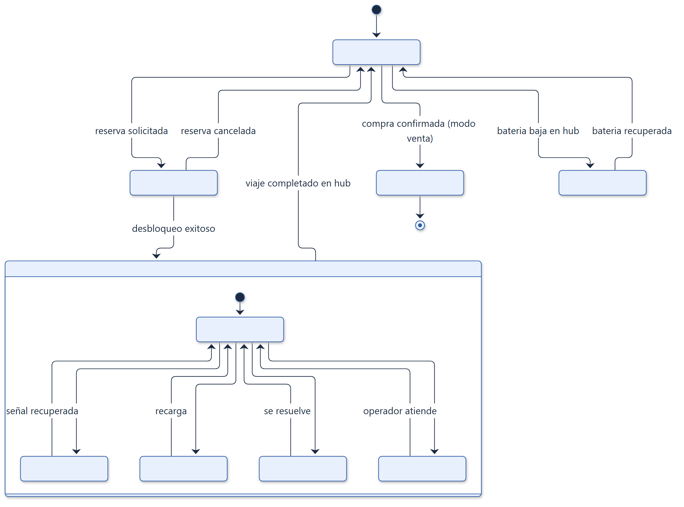

**Qué es/por qué.** Ciclo de vida del vehículo con el estado de alerta anidado en "En viaje" (RF-11).
**Cómo leerlo.** `available | reserved | in_use | sold | offline` + las 4 alertas dentro de "En viaje" (conducción indebida fuera de alcance, H9).

## 13b. Estados de la entrega _(nuevo v2)_

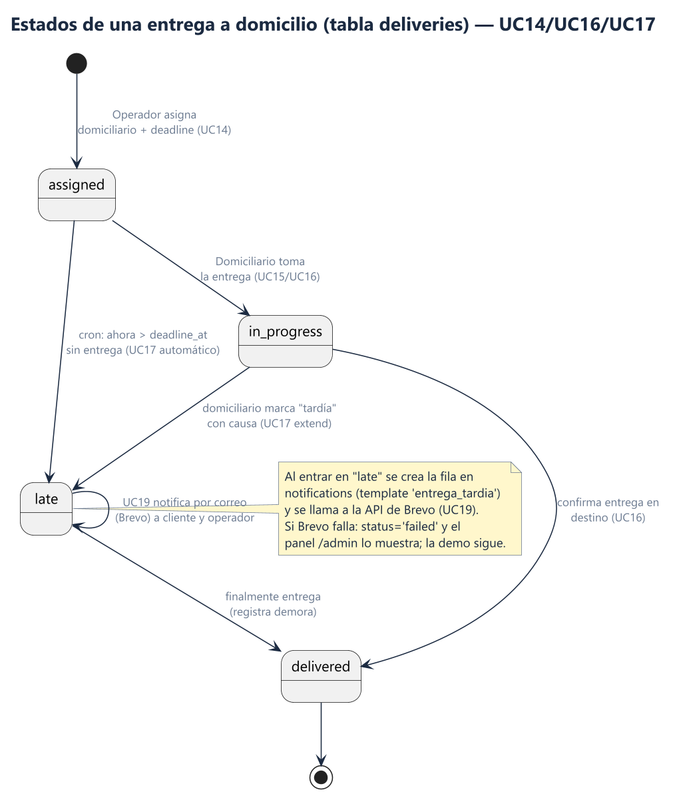

**Qué es.** Ciclo `assigned → in_progress → delivered`, con `late` alcanzable por cron o por el domiciliario.
**Por qué existe.** La tabla `deliveries` necesita su máquina de estados igual que reservas; desde `late` dispara UC19 (correo Brevo).
**Cómo leerlo.** Cada flecha nombra el evento y quién lo provoca. `late → delivered` permite terminar la entrega registrando la demora.

## 14. Modelo entidad–relación (DER v2)

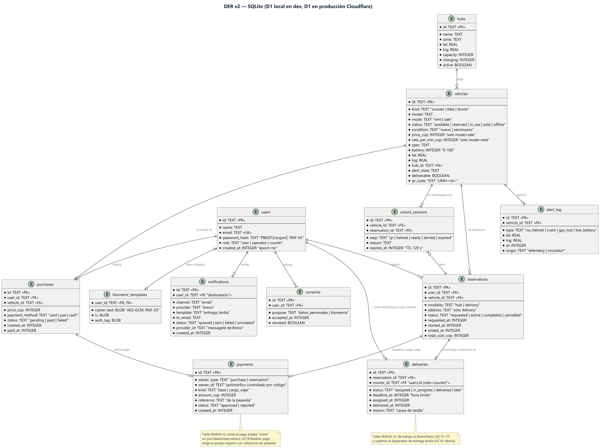

**Qué es.** Las tablas de SQLite con nombres en minúscula plural, alineadas al contrato de dominio.
**Por qué existe.** Contrato de persistencia que Drizzle implementa; es lo que las secuencias citan.
**Cómo leerlo.** `||--o{` = uno a muchos. Nuevas tablas v2: `payments` (pago explícito con referencia), `deliveries` (trabajo del domiciliario) y `notifications` (registro de correos Brevo). `biometric_templates` solo guarda `cipher_text/iv/auth_tag`. `alert_log` es solo-append. `occupied` del hub se calcula, no se almacena. `payments.owner_type/owner_id` es polimórfico controlado por código (compra o reserva).

---

## 15. Checklist de verificación contra el código

- [x] (1-oct) Tipos del cliente alineados con `src/lib/data/types.ts`.
- [x] (8-oct) Nombres de enums alineados a `src/shared/types/domain.ts` (`VehicleStatus`, `UnlockSession.reservationId`, `AlertEvent.source`, `PaymentMethod`).
- [x] (8-oct) Tablas del DER materializadas: `src/server/db/schema.sql` (SQLite/D1-compatible; Drizzle queda opcional para prod).
- [x] (8-oct) `payments`, `deliveries`, `notifications` y rol `courier` implementados + UI (`/entregas`, panel `/admin`).
- [x] (8-oct) Rutas `/api/*` publicadas en el backend de desarrollo (`server/api/handlers.ts`); `docs/api/openapi.yaml` v0.2.0 extendido y **validado con js-yaml** (antes era YAML inválido, D-17).
- [ ] Topics MQTT reales con broker (hoy: topics lógicos + intervalo en proceso; ingresa por `POST /api/ingest`).
- [x] `services/brevo.ts` con clave por env/secret, fallback `simulated`, y prueba unitaria de la rama de fallo (`brevo.test.ts`).
- [ ] Esquema replicado en D1 con `wrangler d1 migrations` al publicar (mismo `schema.sql`).
