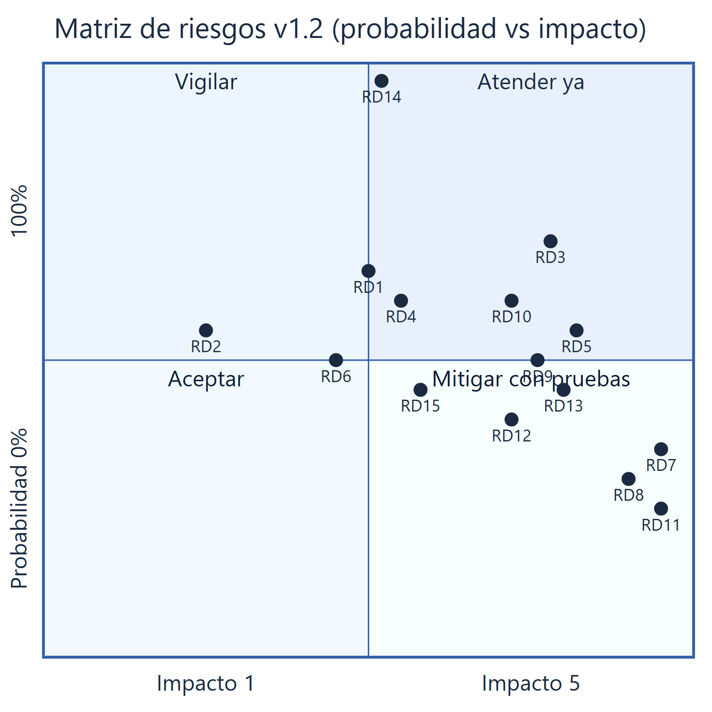

# Análisis de Riesgos del Desarrollo — v1.2 (PROPUESTA)

Plataforma Multimodal de Micromovilidad · UNAB · Ingeniería de Software II
Fecha de la propuesta: 1 de octubre de 2026

> Archivo nuevo. `Analisis_Riesgos_Plataforma_Micromovilidad.docx` (v1.1) no se modificó. Las secciones 1 (introducción), 2 (categorías) y la escala de impacto (1–5) se mantienen como en v1.1. Aquí solo aparece lo que cambia o se completa.

## 0. Cambios respecto a v1.1

| Hallazgo | Cambio                                                                                                                                                        |
| -------- | ------------------------------------------------------------------------------------------------------------------------------------------------------------- |
| H3       | RD9, RD12 y RD13 eran nivel Alto pero no tenían plan SGR. Se agregan (§3).                                                                                    |
| H4       | RD10 pasa de impacto 2 a **4**: un contrato de API ambiguo bloquea frontend y backend, y ya existía el riesgo RD5 que depende de él. Pasa de Bajo a **Alto**. |
| H9       | RD8 se reformula: "conducción indebida" no es parte del SRS (solo 4 alertas).                                                                                 |
| Nuevo    | RD14 (plazos de entregables) y RD15 (despliegue y tiempo real).                                                                                               |
| Criterio | Se agrega puntaje (prob × impacto) como desempate dentro del nivel.                                                                                           |

## 1. Riesgos modificados y nuevos

| ID   | Categoría            | Descripción v1.2                                                                                                                                                                | Prob.                 | Impacto |
| ---- | -------------------- | ------------------------------------------------------------------------------------------------------------------------------------------------------------------------------- | --------------------- | ------- |
| RD8  | Calidad y pruebas    | Fallos del trigger de seguridad al detectar las **cuatro** alertas definidas (sin casco, caída, pérdida de GPS, batería crítica). La conducción indebida está fuera de alcance. | 30 %                  | 5       |
| RD10 | Equipo y proceso     | Falta de acuerdo sobre contratos de API entre quienes implementan IoT/simulación y portal web.                                                                                  | 60 %                  | **4**   |
| RD14 | Requisitos y alcance | Incumplimiento de fechas de entregables (ya ocurrió con el DFD, RF-19, vencido el 30-sep-2026).                                                                                 | 100 % (materializado) | 3       |
| RD15 | Integración          | El host elegido (Cloudflare) puede no soportar WebSocket persistente ni el broker MQTT en proceso, obligando a usar SSE o rediseñar.                                            | 45 %                  | 3       |

## 2. Matriz de riesgos v1.2 (ordenada por nivel y probabilidad)

Criterio de nivel (sin cambio): **Bajo** impacto ≤ 2 · **Medio** impacto = 3 · **Alto** impacto ≥ 4.

| Riesgo                         | Prob. | Imp. | Puntaje | Nivel | SGR                |
| ------------------------------ | ----- | ---- | ------- | ----- | ------------------ |
| RD3 Sobrecarga del equipo de 3 | 70 %  | 4    | 2,80    | Alto  | v1.1               |
| RD10 Contratos de API          | 60 %  | 4    | 2,40    | Alto  | **nuevo**          |
| RD5 Acoplamiento UI–datos      | 55 %  | 4    | 2,20    | Alto  | v1.1               |
| RD9 Desviación de estimación   | 50 %  | 4    | 2,00    | Alto  | **nuevo**          |
| RD13 Cobertura de pruebas      | 45 %  | 4    | 1,80    | Alto  | **nuevo**          |
| RD7 Falsos +/− en facial       | 35 %  | 5    | 1,75    | Alto  | v1.1               |
| RD12 Integración MQTT          | 40 %  | 4    | 1,60    | Alto  | **nuevo**          |
| RD8 Trigger de seguridad       | 30 %  | 5    | 1,50    | Alto  | v1.1 (reformulado) |
| RD11 Datos biométricos         | 25 %  | 5    | 1,25    | Alto  | v1.1               |
| RD1 Cambios de alcance         | 65 %  | 3    | 1,95    | Medio | —                  |
| RD4 Curva IoT/MQTT             | 60 %  | 3    | 1,80    | Medio | —                  |
| RD14 Plazos de entregables     | 100 % | 3    | 3,00    | Medio | **nuevo**          |
| RD6 Latencia del pipeline      | 50 %  | 3    | 1,50    | Medio | —                  |
| RD15 Host y tiempo real        | 45 %  | 3    | 1,35    | Medio | **nuevo**          |
| RD2 SRS vs. simulación         | 55 %  | 2    | 1,10    | Bajo  | —                  |

## 3. SGR nuevos (H3, H4) y para riesgos nuevos

| ID       | Supervisión                                                                                                                                             | Reducción                                                                                                                                           | Gestión (contingencia)                                                                                                   |
| -------- | ------------------------------------------------------------------------------------------------------------------------------------------------------- | --------------------------------------------------------------------------------------------------------------------------------------------------- | ------------------------------------------------------------------------------------------------------------------------ |
| **RD9**  | Registrar horas reales por tarea y comparar con la estimación al cierre de cada avance (21-oct, 25-nov). Indicador: desviación > 25 % dispara revisión. | Re-estimar el Plan tras cada avance con datos reales (ver Plan v1.2 §4.1); dejar de usar la constante de 50 SLOC/PF sin calibrar.                   | Recortar alcance por prioridad de riesgo (primero lo crítico: desbloqueo y alertas) y acordar el recorte con el docente. |
| **RD12** | Monitor de reconexión y de mensajes perdidos del broker en las pruebas de integración.                                                                  | Esquema de mensaje versionado y validado; reconexión automática con reintento; pruebas de integración con broker real en proceso (no con mocks).    | Caer a la ruta alterna: el simulador inyecta eventos directo al dominio sin MQTT, manteniendo el mismo formato.          |
| **RD13** | Reporte de cobertura en cada integración; meta ≥ 80 % en desbloqueo, seguridad y tracking.                                                              | Puerta de calidad en CI: no se integra si baja de la meta; pruebas escritas junto al código; casos de prueba derivados de las secuencias de diseño. | Congelar nuevas funciones hasta recuperar la cobertura del módulo afectado.                                              |
| **RD10** | Revisión del contrato (OpenAPI y tipos compartidos) al inicio de cada avance; cambios solo por solicitud registrada.                                    | Contrato-first: backend publica tipos y OpenAPI antes de implementar; frontend consume solo vía `DataSource`; pruebas de contrato en CI.            | Si el contrato cambia, se versiona y se mantiene la versión anterior hasta migrar.                                       |
| **RD14** | Tablero con fechas y responsables, revisado semanalmente.                                                                                               | Entregables de análisis y diseño se escriben en paralelo al código, no al final.                                                                    | Entrega con retraso explícito y plan de recuperación acordado con el docente.                                            |
| **RD15** | Prueba temprana (spike) de WebSocket y MQTT en el host elegido.                                                                                         | Diseño con SSE de respaldo (decisión D3) y simulador desacoplado del host.                                                                          | Despliegue de demostración en un host que soporte procesos persistentes; la URL pública sigue sirviendo el portal.       |

Responsables de supervisión: igual que v1.1 (§7.1). Los riesgos RD10, RD14 y RD9 los supervisa el responsable de planeación; RD12, RD13 y RD15, el líder técnico.

## 4. Conclusiones de la revisión

1. Tres riesgos de nivel Alto no tenían respuesta documentada (H3); ya la tienen.
2. RD10 estaba subestimado (H4): todo el desacoplamiento de RD5 depende de que el contrato de API sea claro.
3. El riesgo de plazos ya se materializó (DFD): se registra como RD14 para que el equipo aprenda de él y no lo trate como una excepción.
