# Compilación de interfaces

Pantallas del sistema en el orden en que un usuario las encuentra, con captura real (Playwright sobre la app en http://localhost:8080), qué muestra, para qué sirve y el requisito que cubre. **No es un manual de usuario.**

Generado automáticamente por `_tools/capturar.mjs` desde `_tools/pantallas.json`. Para actualizar: levantar el backend (`npm run dev:api`), preparar la historia de datos (`powershell -File _tools/seed-capture.ps1`) y ejecutar `node _tools/capturar.mjs`.

## 1. Landing (escritorio)

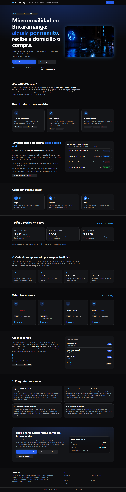

- **Ruta:** `/` · **Vista:** 1366×900
- **Qué muestra:** Propuesta de valor, servicios, entrega a domicilio con domiciliario, tarifas reales en COP, seguridad IoT, catálogo, hubs, FAQ y cuentas de demostración.
- **Para qué sirve:** Presenta el negocio completo (lo que los documentos prometen) y lleva al usuario a la app.
- **Requisitos:** RF-01

## 2. Entrada en móvil

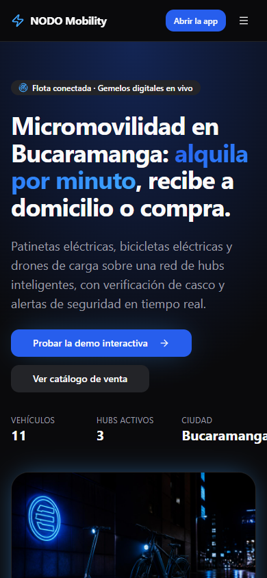

- **Ruta:** `/` · **Vista:** 390×844
- **Qué muestra:** En pantalla pequeña la landing lleva directo al mapa.
- **Para qué sirve:** Evita pasos al usuario móvil; la redirección es del lado del cliente para no dañar el SEO.
- **Requisitos:** RF-01

## 3. App: mapa en modo alquiler

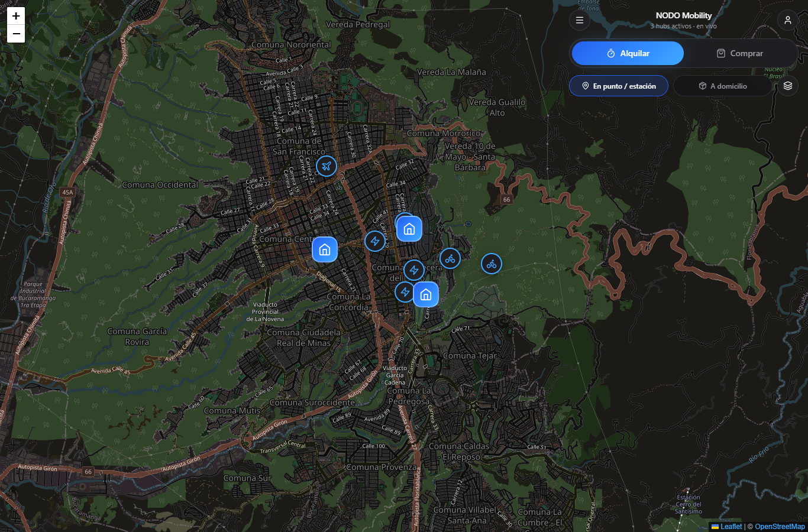

- **Ruta:** `/app` · **Vista:** 1366×900
- **Qué muestra:** Mapa con vehículos disponibles y hubs; la posición se actualiza en vivo desde SQLite por SSE.
- **Para qué sirve:** Encontrar y elegir un vehículo para alquilar.
- **Requisitos:** RF-04, RF-05, RF-06, RF-08

## 4. App: modo compra

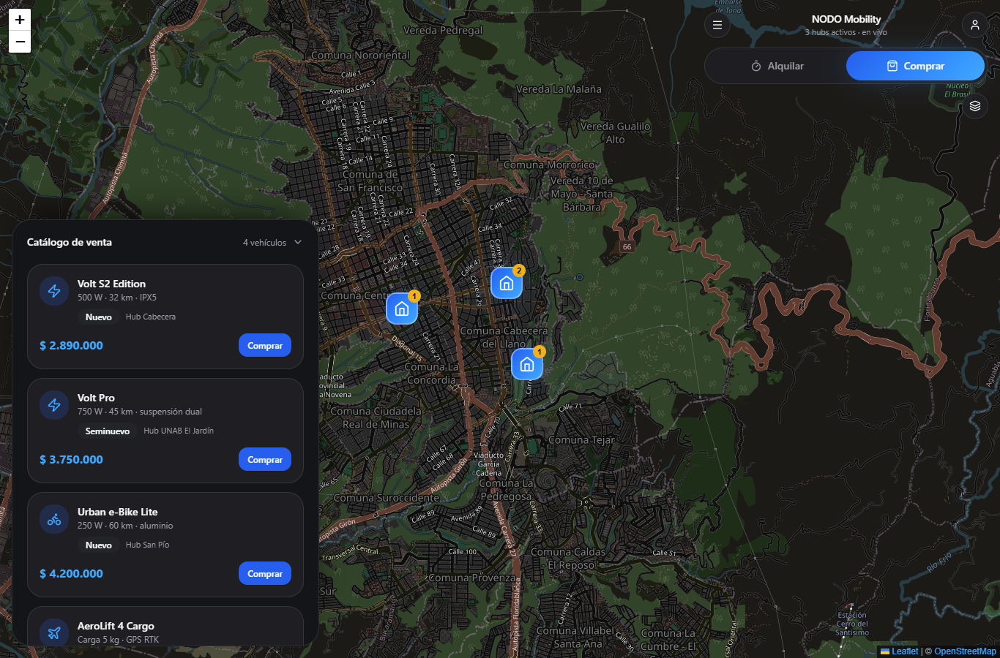

- **Ruta:** `/app` · **Vista:** 1366×900
- **Qué muestra:** Stock en venta por hub con precio y condición.
- **Para qué sirve:** Comprar un vehículo.
- **Requisitos:** RF-02, RF-03, RF-06

## 5. Catálogo público

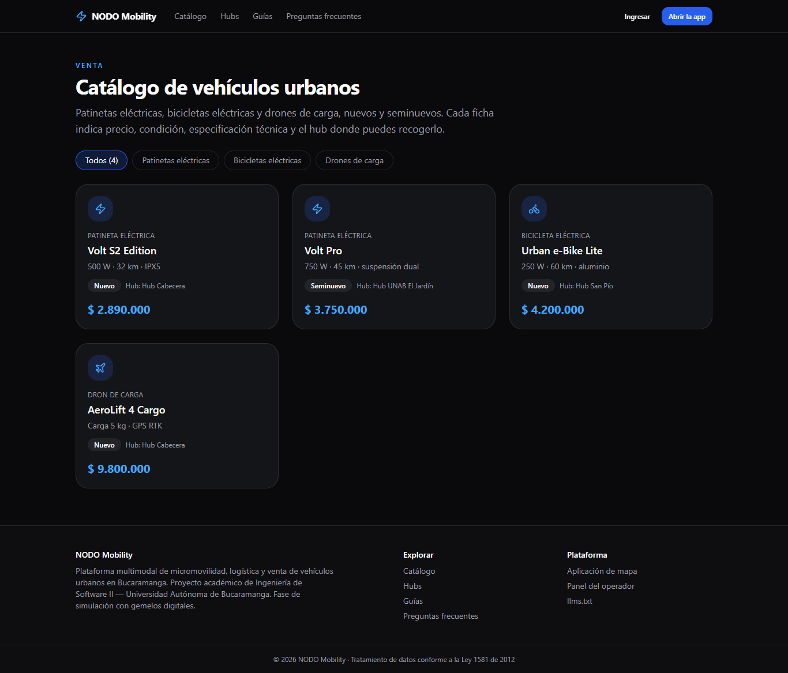

- **Ruta:** `/catalogo` · **Vista:** 1366×900
- **Qué muestra:** Lista de vehículos en venta.
- **Para qué sirve:** Página indexable para buscadores (SEO).
- **Requisitos:** RF-02

## 6. Listado de hubs

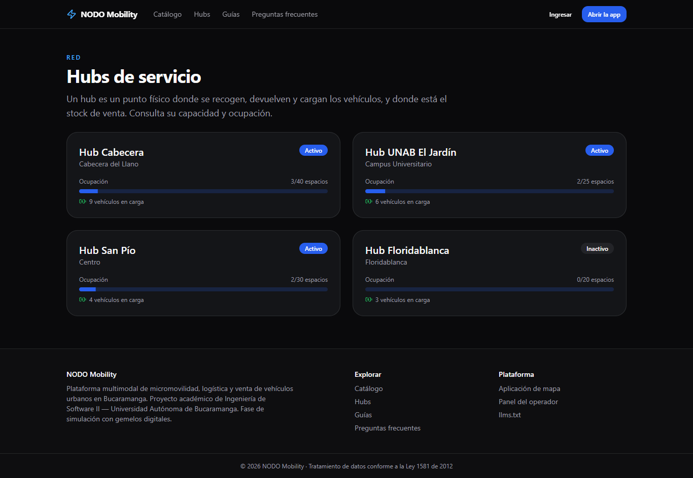

- **Ruta:** `/hubs` · **Vista:** 1366×900
- **Qué muestra:** Hubs con capacidad y ocupación.
- **Para qué sirve:** Consultar puntos de recogida.
- **Requisitos:** RF-06, RF-07

## 7. Detalle de un hub

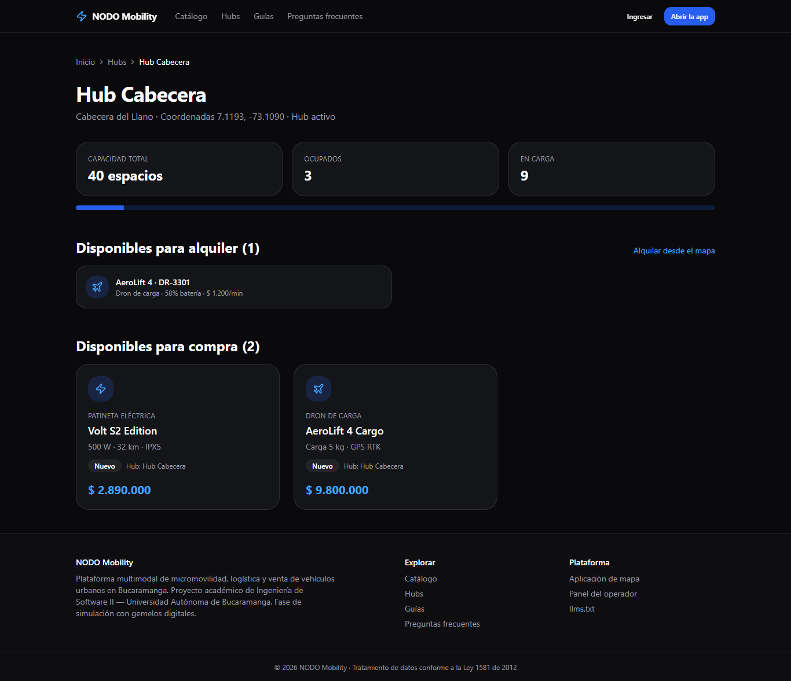

- **Ruta:** `/hubs/HUB-01` · **Vista:** 1366×900
- **Qué muestra:** Capacidad, ocupados, en carga y vehículos del hub.
- **Para qué sirve:** Decidir a qué hub ir.
- **Requisitos:** RF-07

## 8. Registro con consentimiento

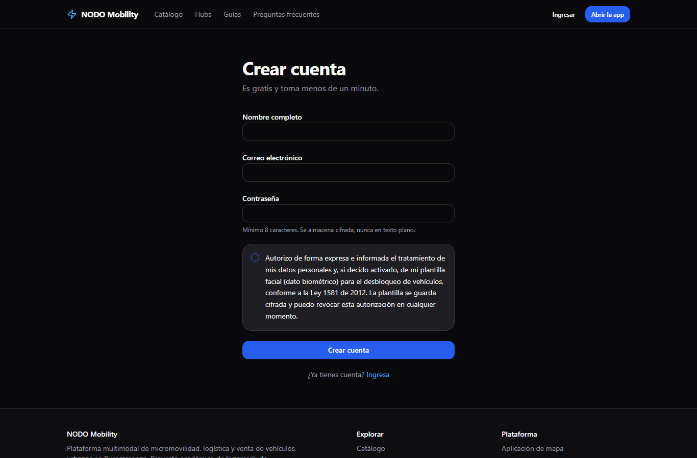

- **Ruta:** `/registro` · **Vista:** 1366×900
- **Qué muestra:** Formulario de cuenta y consentimiento explícito (Ley 1581).
- **Para qué sirve:** Crear cuenta de forma legal.
- **Requisitos:** RF-20, RNF-03, RNF-05

## 9. Inicio de sesión

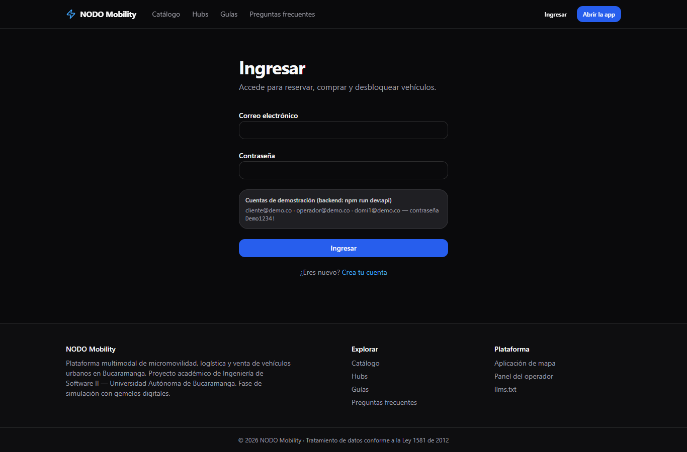

- **Ruta:** `/login` · **Vista:** 1366×900
- **Qué muestra:** Correo y contraseña, más el bloque de cuentas de demostración.
- **Para qué sirve:** Acceder a compra, alquiler, desbloqueo y bandejas por rol.
- **Requisitos:** RF-21

## 10. Panel de telemetría

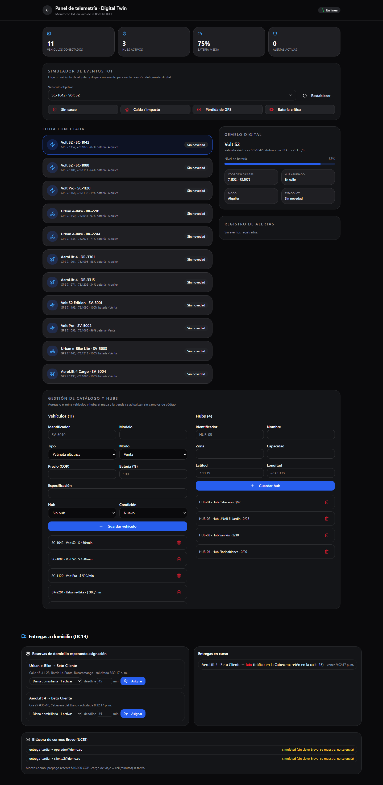

- **Ruta:** `/admin` · **Vista:** 1440×900
- **Qué muestra:** KPIs de flota, tabla de gemelos digitales, simulador de alertas y bitácora; con sesión de operador.
- **Para qué sirve:** Que el operador vigile la flota con datos reales de SQLite.
- **Requisitos:** RF-13, RF-14, RF-16, RF-17

## 11. Preguntas frecuentes

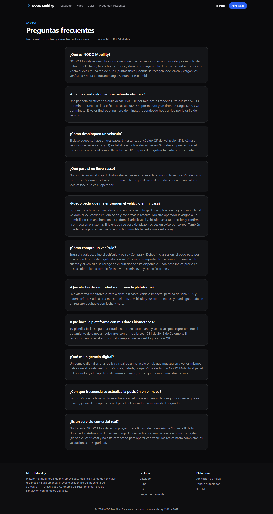

- **Ruta:** `/faq` · **Vista:** 1366×900
- **Qué muestra:** Preguntas y respuestas.
- **Para qué sirve:** Responder dudas y ser citable por buscadores y asistentes de IA.
- **Requisitos:** RNF-11

## 12. Guías

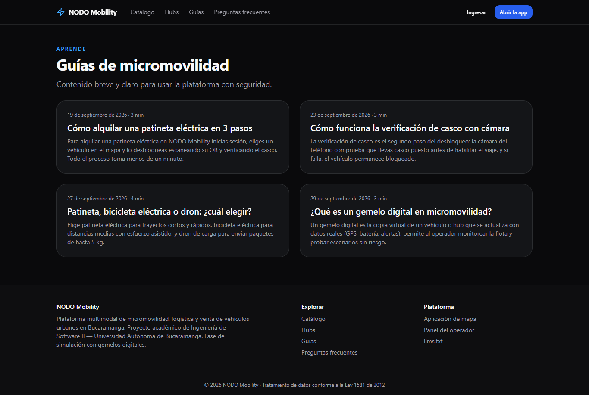

- **Ruta:** `/guias` · **Vista:** 1366×900
- **Qué muestra:** Artículos de ayuda.
- **Para qué sirve:** Contenido para SEO.
- **Requisitos:** RNF-11

## 13. Bandeja del domiciliario

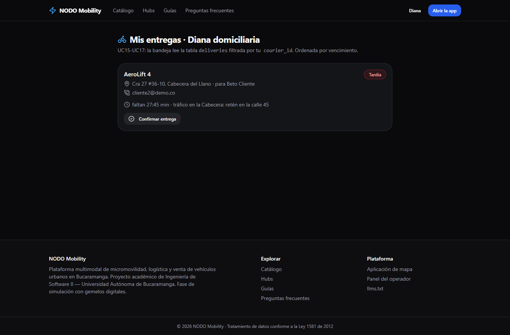

- **Ruta:** `/entregas` · **Vista:** 1366×900
- **Qué muestra:** Entrega asignada a domi1 con dirección, cliente, cuenta atrás al deadline y acciones Iniciar / Confirmar / Marcar tardía.
- **Para qué sirve:** UC15-UC17: el domiciliario ejecuta la entrega a domicilio desde su propia vista.
- **Requisitos:** RF-25

## 14. Entregas y correos en el panel del operador

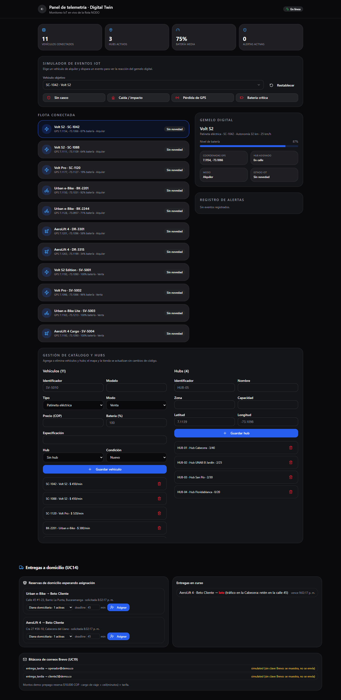

- **Ruta:** `/admin` · **Vista:** 1440×900
- **Qué muestra:** Bloque inferior del /admin: reservas de domicilio pendientes de asignación, entregas en curso y bitácora de correos Brevo con estado sent/simulated/failed.
- **Para qué sirve:** UC14: asignar entregas al domiciliario; UC19: verificar que el aviso de retraso se registró.
- **Requisitos:** RF-25, RF-27
